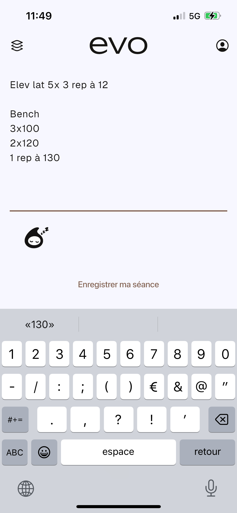
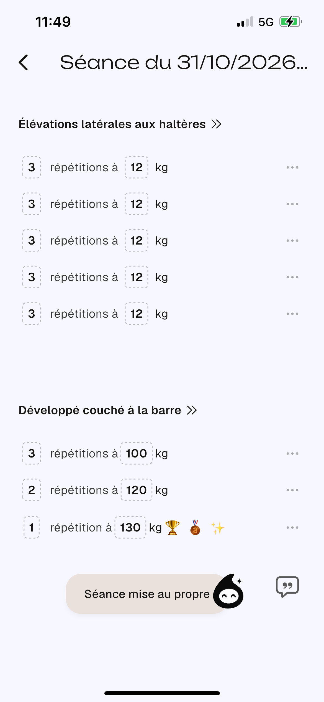
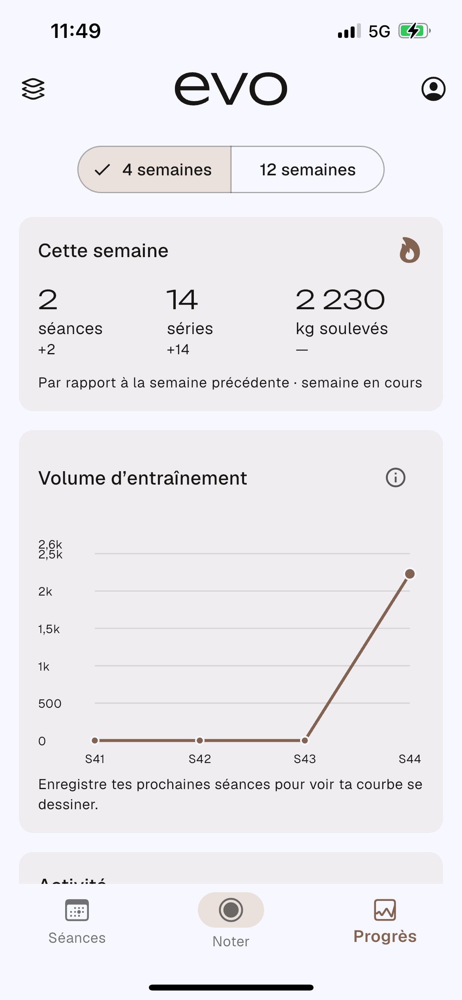
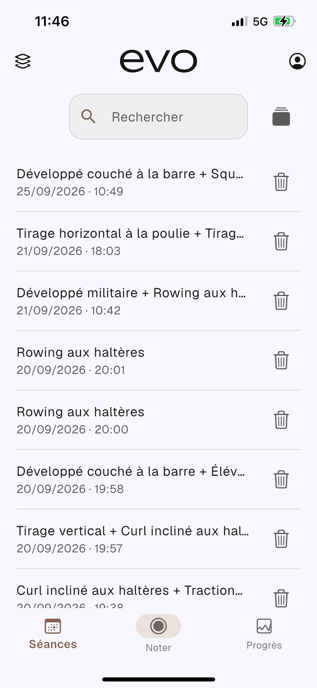
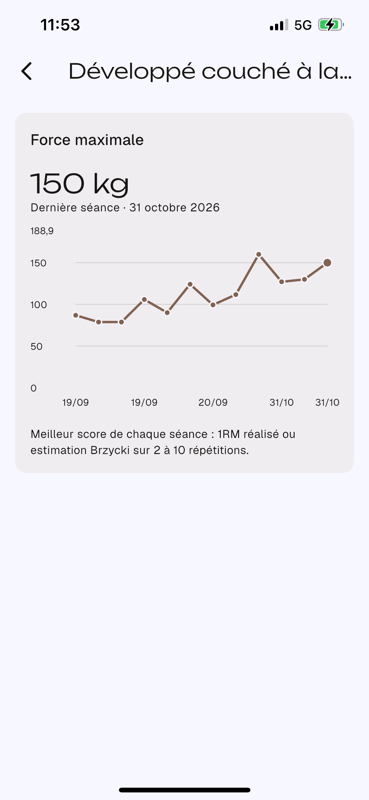
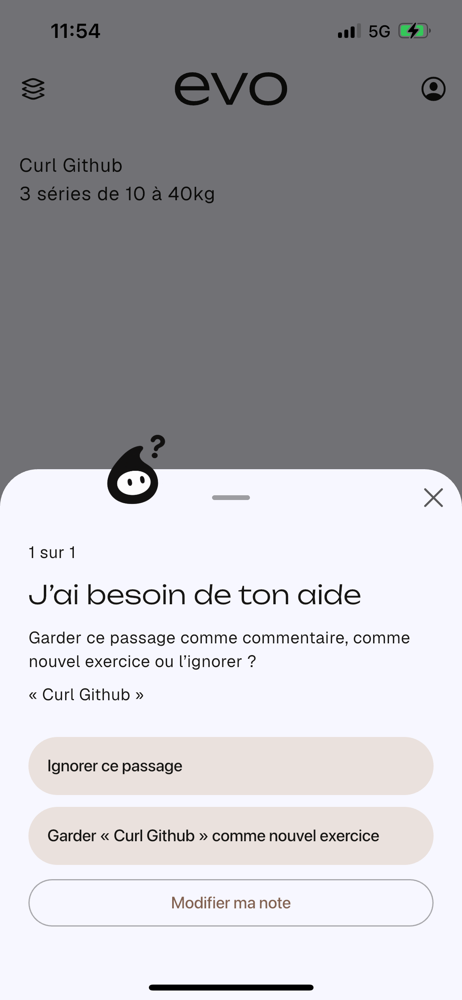

# evo — Write your workout. Track your progress.

**Independent mobile-app project · iOS prototype · Flutter / Dart / Firebase**

> A workout diary built around a simple idea: **log your training in your own words**, and have the app turn it into useful exercise history, personal records and progress statistics.

**Closed-source product showcase.** This repository intentionally contains **no application source code, parsing logic, tests, configuration, API keys or build files**. The app is under development and may be published on the App Store in the future; it is **not** presented as an already released App Store product.

## Product preview

| Free-form workout note | Structured session | Training statistics |
| :---: | :---: | :---: |
|  |  |  |

| Workout history | Exercise progression | Resolve ambiguous exercise names |
| :---: | :---: | :---: |
|  |  |  |

*Screenshots supplied from an iPhone development build. They illustrate the product's current interface, not a public release.*

## The problem

Traditional training trackers often require multiple taps for every exercise, set, repetition and weight. Handwritten or free-form notes are much faster to capture, but they are hard to search, aggregate or visualize later.

**evo** explores the middle ground: keep a fast, flexible note-taking experience while creating usable training records in the background.

## The product journey

**1. Capture quickly.** Type workout notes with exercises, sets, repetitions, weights and optional comments using natural phrasing.

**2. Turn messy input into structured entries.** The app interprets workout text, helps reconcile ambiguous exercise names and lets the user review or correct the session.

**3. Build a history.** Sessions and exercise-level records can be revisited over time.

**4. Track progress.** Visualizations cover workout activity, progression by exercise and personal-record milestones.

## Technical decisions — at a safe level

| Area | Approach |
| --- | --- |
| **Client** | Flutter and Dart, with an iOS-first development focus |
| **App state** | BLoC / Cubit-style state management |
| **Persistence & accounts** | Firebase Authentication and Cloud Firestore services |
| **Workout understanding** | Custom structured text interpretation and exercise-name disambiguation; **not** claimed to be a generative AI/LLM feature |
| **Analytics** | Exercise history, personal records, aggregate training statistics and charts (`fl_chart`) |
| **Quality** | Dedicated Dart tests were developed for session interpretation, exercises, statistics and related behavior; tests are not distributed in this showcase |

### Simplified architecture

```text
Flutter UI (iOS-first)
        |
State management (BLoC / Cubit)
        |
  Workout-domain services
        +--- free-form note interpretation
        +--- exercise matching / correction
        +--- history / records / statistics
        |
 Firebase Auth + Cloud Firestore
```

*This deliberately high-level diagram communicates responsibilities, not proprietary algorithms, rules, schemas or implementation details.*

## Engineering challenges

- Handling **non-standard workout notation**, rather than forcing all users into rigid forms.
- Translating free-form sessions into consistent exercise records while allowing manual correction.
- Dealing with exercise aliases and **ambiguous names** without silently rewriting a user's intent.
- Maintaining useful statistics when the underlying workout history can be edited.
- Designing an experience that feels fast at entry time but still supports review and rich analytics.

## Current status

- **Platform:** iOS development prototype. Android / web / desktop releases are **not** claimed.
- **Distribution:** no public download or App Store link is provided yet.
- **Source:** private by design; this GitHub repository is a **product/engineering case study**, not an open-source SDK or runnable app.
- **Screenshots:** captured from a development build; they may evolve prior to launch.

**[Read the product case study](docs/PRODUCT_CASE_STUDY.md) · [Technology overview](docs/TECHNICAL_OVERVIEW.md)**

### Source code and intellectual property

**All rights reserved.** No permission is granted to reuse the application design, assets, logic or implementation. The screens shown are for portfolio demonstration only. No code, Firebase rules, project IDs, local databases, security configuration or proprietary parsing rules are provided here.
